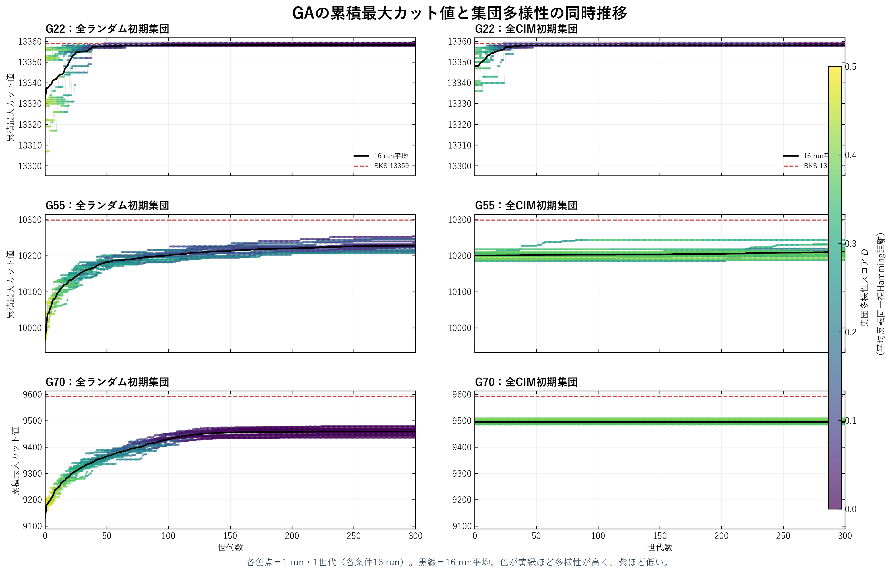

# GAの累積最大カット値と多様性の同時推移

実験日: 2026-09-14 / G22・G55・G70 / 各条件16 run・300世代  
新規GA実行: **なし（保存済み軌跡の再描画）**

> 各runの累積最大カット値を縦軸、世代を横軸、同じrun・世代の集団多様性を点の色で示す。

## 図

- 各色点は1 run・1世代。
- 黒線は16 runの平均累積最大カット値。
- 多様性 $D$ は、全反転を同一分割とした集団内平均ペアHamming距離。
- 黄緑ほど高多様性、紫ほど低多様性。
- 世代0は初期集団の全個体にTabu Searchを適用した後。

## 注意

全ランダム初期集団と全CIM初期集団では世代0の品質が一致していない。この図は品質と多様性の同時推移を示すが、多様性が性能差を生んだという因果検証ではない。

## 再現

解析コード: `modules/2026-09-14_GA_DIVERSITY_COLORED_TRAJECTORY.py`  
元データ: `results/2026-09-14/ga_diversity_trajectory/v1_G22_G55_G70_nt16_gen300_measured`  
集計値: `summary.csv` / 入力ハッシュ: `provenance.json`  
TeX: `report.tex` / PDF: `report.pdf`
