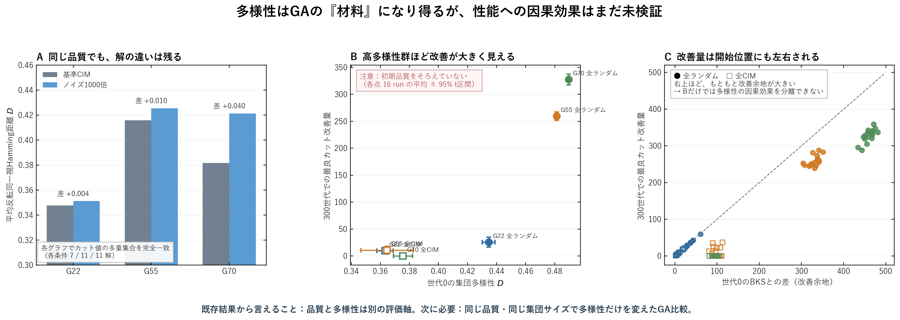

# GA多様性：既存結果から言えることと言えないこと

実験日: 2026-09-14 / 新規GA実行: **なし** / 解析対象: G22・G55・G70

> 品質と多様性は別の評価軸だが、多様性がGA性能を上げるという因果効果はまだ未検証である。

## 主図

- A: カット値の多重集合を完全一致させても、平均距離は条件間で異なる。
- B: 未調整のGA軌跡では、高多様性群ほど改善が大きく見える。
- C: ただし改善量は世代0のBKS差（改善余地）にも強く左右され、Bから因果効果は分離できない。

## 次の検証

同じ品質分布・同じ集団サイズ・同じGA設定と計算予算で、低距離／高距離集団を複数構成し、対応する乱数で最終性能を比較する。

## 再現

解析コード: `modules/2026-09-14_GA_DIVERSITY_EXISTING_EVIDENCE.py`  
集計値: `group_summary.csv`, `run_data.csv`  
入力ハッシュ: `provenance.json`  
TeX原稿: `report.tex` / PDF: `report.pdf`
