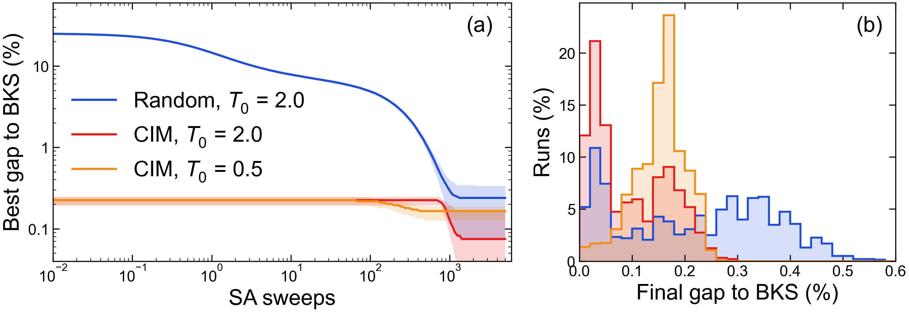

# SA の探索経路：開始地点と開始温度の比較 — G22

実験日: 2026-11-01 / グラフ: **G22**(N=2000, 辺19990) / 既知ベスト: **13359**
再現コード: `scripts/benchmarks/sa_trajectory.py`(テスト: `tests/test_sa_trajectory.py`)
データ: `results/2026-11-01/sa_trajectory/v3_G22_P100_K256_m16_cim2400_S500_5000/`

---

## 1. この実験で何を試したか(一言で)

> 開始温度をそろえると、CIM 開始は 5000 スイープ後も SA 1 本あたりの平均で良い(BKS との差 0.097% vs 0.223%)。
> ただし CIM 開始の開始温度を 0.5 に下げると、到達点は 0.154% に下がる。

## 2. 数式の変更点

CIM の基準更新方程式(`docs/assets/base_update_equations.png`)は**変更していない**。
SA も `modules/SA.py` と同じ更新で、累積最良 cut と現在の cut の記録だけを足した。

## 3. 実験条件

| 項目 | 値 |
|---|---|
| CIM | 2400 ラウンド、1 プール 256 回、独立に 100 プール(seed 1000 から連番) |
| CIM 開始の初期解 | 各プールの cut 上位 16 個(計 1600 個) |
| ランダム開始の初期解 | 一様ランダム 1600 個 |
| SA | 500 / 5000 スイープ、終了温度 0.001、各条件 1600 本(本ごとに別の乱数) |
| 開始温度 $T_0$ | 0.5 / 2.0(開始地点との 4 通り) |
| 検定 | 16 本 1 組(100 組)の平均・最良に Mann–Whitney 検定。区間は組単位のブートストラップ 95% |

確認したこと:

- `sa_traj` の最終最良値は `simulate_sa_warm` と 32 本すべてで完全に一致(開始温度 2 通り)。
- 先頭 2 プールの CIM の cut は `seed_value_pilot/v12` の先頭 512 個と完全に一致。
- v1(主条件 2 つだけの実行)の経路を、主条件の 2 つで完全に再現。
- 既存の実験と一致:ランダム開始 $T_0=2.0$ の平均は 5000 スイープで 13329.2(`random_init_sa/v4` は 13328.2)、500 スイープで 13244.6(同 13245.6)。

## 4. 結果サマリー

カットは SA の最終最良値、差は BKS との差(平均)。「0.03% 以内」は差 0.03% 以内に届いた本の割合。

| スイープ | 開始地点 | $T_0$ | 平均カット | 標準偏差 | BKS との差 | 16 本の最良の平均 | 0.03% 以内 |
|---|---|---|---|---|---|---|---|
| 5000 | **CIM** | **2.0** | **13345.99** | 9.55 | **0.097%** | 13357.35 | 22.8% |
| 5000 | CIM | 0.5 | 13338.43 | 6.53 | 0.154% | 13350.94 | 2.2% |
| 5000 | ランダム | 2.0 | 13329.21 | 19.23 | 0.223% | 13356.47 | 11.1% |
| 5000 | ランダム | 0.5 | 13212.46 | 26.86 | 1.097% | 13261.39 | 0% |
| 500 | CIM | 2.0 | 13332.25 | 6.52 | 0.200% | 13346.18 | 0% |
| 500 | CIM | 0.5 | 13333.10 | 5.73 | 0.194% | 13344.53 | 0% |
| 500 | ランダム | 2.0 | 13244.60 | 23.54 | 0.856% | 13287.90 | 0% |
| 500 | ランダム | 0.5 | 13120.09 | 30.58 | 1.788% | 13176.37 | 0% |

主な比較(5000 スイープ、差はカット):

| 比較 | 平均の差 [95% 区間] | p | 16 本の最良の差 [95% 区間] | p |
|---|---|---|---|---|
| CIM $T_0=2.0$ − ランダム $T_0=2.0$ | **+16.78** [15.73, 17.85] | 7.3e-34 | +0.88 [0.52, 1.25] | 1.4e-5 |
| CIM $T_0=0.5$ − ランダム $T_0=2.0$ | +9.23 [8.17, 10.28] | 3.7e-29 | **−5.53** [−6.58, −4.52] | 7.6e-17 |
| CIM $T_0=2.0$ − CIM $T_0=0.5$ | +7.55 [6.92, 8.17] | 1.4e-32 | +6.41 [5.45, 7.43] | 5.7e-24 |

## 5. 図と読み取り

- (a) 累積最良の BKS との差。線は中央値、帯は 25〜75%。ランダム開始の中央値は、CIM 開始のどちらの条件にも最後まで追いつかない。
- (a) CIM $T_0=2.0$ は、高温の間は最良値が動かず、約 900 スイープ付近で $T_0=0.5$ を追い越す。
- (b) 最終値の分布。CIM $T_0=0.5$ は幅が狭く、BKS 近くにほとんど届かない。ランダム $T_0=2.0$ は幅が広い。

## 6. 考察

- 開始地点の効果は長い SA でも残る。$T_0=2.0$ で加熱すると現在の cut は一度 12500 付近まで下がるが、同じスイープ時点のランダム開始より高いまま進み、約 20 高い値で止まる。
- 低い $T_0$ で到達点が下がるのは、初期解の近くにとどまりやすいためと考えられる(この実験では距離を測っていないので仮説)。
- 同じ総時間の比較(`selection_eval/v17`, `v29`)で長い SA のランダム初期化が勝つのは、本数の差(16 本と 132 本)による。実際、ランダム 132 本の最良は 13358.04 で、今回の CIM 16 本の最良 13357.35($T_0=2.0$)を上回る。

## 7. 注意点・今後の課題

- G22 の 1 問題のみ。ほかの問題では同じとは限らない。
- 組は独立だが、CIM の 100 プールは同じパラメータなので、CIM パラメータへの依存は見ていない。
- 500 スイープと 5000 スイープは冷却の速さが違うので、(a) の 500 スイープ時点の値は、500 スイープの SA の最終値とは別物。
- 2026-10-16 の `seed_value_pilot/v3`(CIM 600 ラウンド)から作った 16 本のみの経路は条件が違うため、この結果で置き換える。
- 次:ほかの問題で同じ 4 条件を調べる。CIM 開始に最適な開始温度を調べる。
