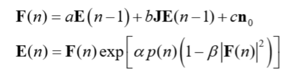

# 同じ総時間での比較を、結果①と同じデータの取り方でやり直す — G22

実験日: 2026-11-10 / グラフ: **G22**(N=2000, 辺19990) / 既知ベスト: **13359**
再現コード: `scripts/benchmarks/equal_time_pools.py`
データ: `results/2026-11-10/equal_time_pools/v3_G22_P100_K256_m16_cim2400_T2_S500_5000/`

---

## 1. この実験で何を試したか(一言で)

> 中間発表の結果④(同じ総時間での比較)は、事前に回した結果(CIM の候補 512 個に各 16 回の SA、ランダム開始 512 本)から
> 抜き出して作っていた。これを結果①(`sa_trajectory` v3)と同じく **組ごとにすべて新しく回す**取り方でやり直した。
> 結論は前と同じで、**500 スイープでは CIM 開始が有利、5000 スイープではランダム開始が有利**(どちらも $p < 0.001$)。
> ただし 5000 スイープの差は平均 0.67 カットと小さい。

## 2. 数式の変更点

CIM・SA の更新式は変えていない(基準式のまま)。変えたのは比較のためのデータの取り方だけ。

## 3. 実験条件

| 項目 | 値 |
|---|---|
| 1 組 | CIM 2400 周回を独立 seed で $K = 256$ 回 → カット値の上位 16 個から SA を 1 本ずつ → 16 本の最良値 |
| CIM の組 | 結果①と同じ 100 組(`sa_trajectory` v3 の `top_signs`)。CIM 開始側の SA も同じ seed で、結果①の値を完全に再現した |
| ランダム開始 | 組ごとに新しいランダム解から、同じ総時間で回せる本数(500 スイープ 1156 本、5000 スイープ 134 本)。本数は結果④の `selection_eval` と同じ |
| SA | `modules/SA.py` の `simulate_sa_warm`、開始温度 2.0 → 0.001(両者共通) |
| 組数 | 100 |
| 比べる量 | 組ごとの最良値。検定は 100 組の Mann–Whitney(両側)、差の区間は組単位のブートストラップ 95% |

## 4. 結果サマリー

| スイープ | 条件 | 本数 | 最良値の平均 | BKS との差 [%] (95% 区間) | 1 本の平均の差 [%] |
|---|---|---|---|---|---|
| 500 | ランダム開始 | 1156 | 13324.24 | 0.260 [0.248, 0.272] | 0.853 |
| 500 | **CIM 開始** | 16 | **13346.18** | **0.096** [0.091, 0.101] | 0.200 |
| 5000 | **ランダム開始** | 134 | **13358.02** | **0.0073** [0.0069, 0.0078] | 0.232 |
| 5000 | CIM 開始 | 16 | 13357.35 | 0.0124 [0.0109, 0.0138] | 0.097 |

差(CIM 開始 − ランダム開始、カット値):

- 500 スイープ:+21.94 [20.21, 23.66]、$p = 6 \times 10^{-32}$
- 5000 スイープ:−0.67 [−0.88, −0.47]、$p = 4 \times 10^{-11}$

BKS に到達した組:5000 スイープでランダム開始 6 組、CIM 開始 1 組。

## 5. 図と読み取り

図はスライド用に別途作成(`make_v27_figs.py`、`res_equal_time_pools_g22.png`)。

- 結果④(抜き出し方式)と向きも大きさもほぼ同じ。抜き出し方式の G22 は 500 スイープで 0.277 / 0.113、5000 スイープで 0.0075 / 0.0119 だった。
- 5000 スイープの CIM 開始側の値は、結果①の「16 本の最良値」と同じ 16 本なので一致する(0.0124%)。

## 6. 考察 — 何が効いたのか

1 本あたりでは 5000 スイープでも CIM 開始が良い(0.097% 対 0.232%)。それでも同じ総時間の最良値で負けるのは、
総時間の 88% を CIM に使うためランダム開始が 8 倍の本数を回せること、CIM 開始は結果のばらつきが小さく最良値が伸びにくいことによる。

## 7. 注意点・今後の課題

- G22 の 1 問題だけ。G55・G70 で同じ取り方をそろえるのは卒論に回す。
- 5000 スイープの差は 0.67 カット(0.005 ポイント)で、統計的には有意だが実用上の差は小さい。
- 総時間は結果④と同じ測定値(24 並列で CIM と SA を別々に測った 1 本あたりの時間)を使った。
