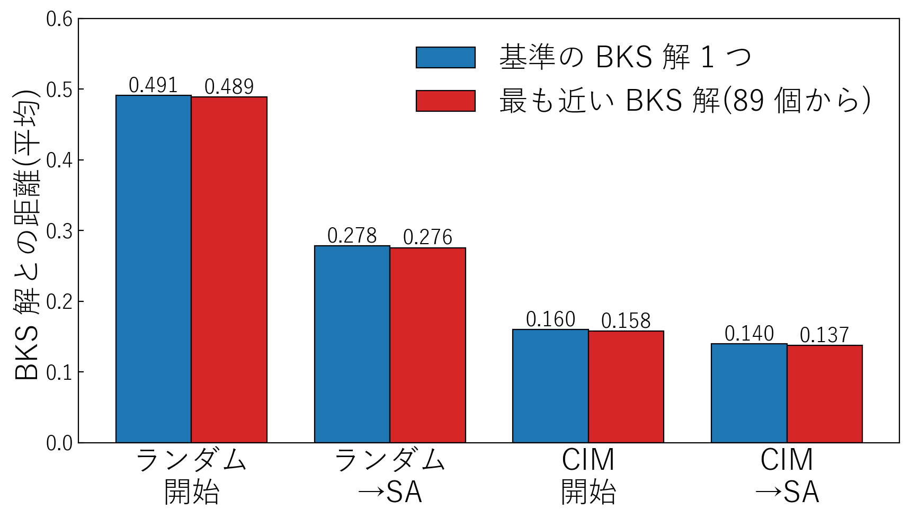
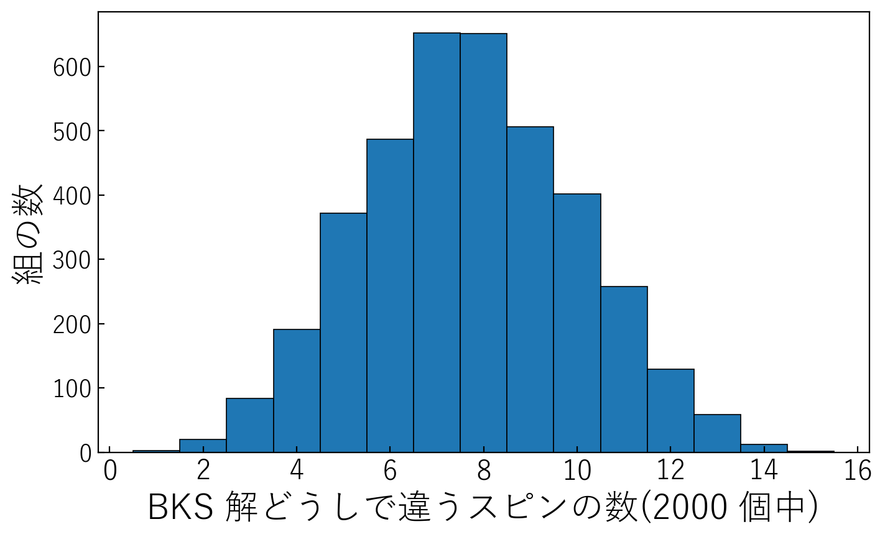

# BKS 解を多数集めて結果③の距離を測り直す — G22

実験日: 2026-11-11 / グラフ: **G22**(N=2000, 辺19990) / 既知ベスト: **13359**
再現コード: `scripts/benchmarks/bks_set_distance.py --target 100 --max-runs 7200`、図は `scripts/plotting/plot_bks_set_distance.py`
データ: `results/2026-11-11/bks_set_distance/v3_G22_S42104_target100/`

---

## 1. この実験で何を試したか(一言で)

> 結果③(`2026-11-07/sa_start_distance/v1`)は、BKS(13359)に届いた解 **1 つだけ**を基準に距離を測っていた。
> ランダム開始の長い SA を 7,200 本回して、**互いに異なる BKS 解を 88 個**集め、各解から「最も近い BKS 解」までの距離で測り直した。
> 88 個の BKS 解は**すべて 1 つの塊**で、どの 2 つも 1〜15 スピンしか違わない(距離 0.0075 以下)。
> そのため、距離は基準を変えてもほぼ同じ(差は 0.003 以下)。結果③の結論(CIM の解は BKS 解に近い:CIM 開始 0.16、ランダム開始 0.49)はそのまま成り立つ。

## 2. 数式の変更点

CIM・SA の更新式は変えていない(基準式のまま)。変えたのは、距離を測るときの基準解(1 つ → 集めた BKS 解のうち最も近いもの)だけ。

距離は、全反転を同じ解とみなした正規化ハミング距離 $d = \min(h,\, n-h)/n$($h$ は違うスピンの数、$n = 2000$)。0 は同じ解、0.5 は無関係な解。

## 3. 実験条件

| 項目 | 値 |
|---|---|
| BKS 解の集め方 | ランダム開始の SA(温度 2.0 → 0.001、42,104 スイープ = 結果④の長い SA と同じ)を 240 本ずつ回し、カット値が 13359 の解を保存 |
| 回した本数 | 7,200 本(上限)。BKS に届いたのは 88 本(1.2%)で、88 個すべて互いに異なる解。目標の 100 個には届かず上限で止めた |
| 測り直した解 | 結果③と同じ 4 集合(各 1,600 解 = 100 組 × 16 本):ランダム開始、ランダム開始 → SA、CIM 開始、CIM 開始 → SA。SA は温度 2.0・5000 スイープ |
| 再現の確認 | 4 集合を同じ seed で作り直し、最終カット値が結果①と、基準解 1 つとの距離が結果③と完全に一致することを確認した |
| 基準の比較 | (a) 結果③の基準解 1 つ、(b) 89 個(元の基準解 + 集めた 88 個)の中で最も近い BKS 解 |
| 塊の判定 | 距離 0.05 未満でつながる BKS 解を同じ塊とみなす(単連結) |

## 4. 結果サマリー

BKS 解との距離(1,600 解の平均。かっこ内は中央値):

| 集合 | (a) 基準解 1 つ | (b) 最も近い BKS 解 | 差 (a) − (b) |
|---|---|---|---|
| ランダム開始 | 0.491 (0.493) | 0.489 (0.491) | 0.002 |
| ランダム開始 → SA | 0.278 (0.252) | 0.276 (0.250) | 0.003 |
| **CIM 開始** | **0.160** (0.168) | **0.158** (0.166) | 0.002 |
| **CIM 開始 → SA** | **0.140** (0.131) | **0.137** (0.128) | 0.003 |

BKS 解どうしの構造:

| 項目 | 値 |
|---|---|
| 塊の数(距離 0.05 未満でつながる) | **1**(88 個すべて) |
| BKS 解どうしの距離 | 平均 0.0039(約 8 スピン)、最小 0.0005(1 スピン)、最大 0.0075(15 スピン) |
| 元の基準解と集めた BKS 解の距離 | 平均 0.0040、最小 0.0015(3 スピン)、最大 0.0070(14 スピン) |

1 解あたりの距離の縮み((a) − (b))は中央値 0.002〜0.0025、最大でも 0.006(12 スピン)。

## 5. 図と読み取り

- 4 つの集合とも、青(基準解 1 つ)と赤(最も近い BKS 解)の差は 0.003 以下で、並び順(ランダム開始 > ランダム→SA > CIM 開始 > CIM→SA)も変わらない。

- 88 個の BKS 解の全 3,828 組で、違うスピンは 1〜15 個(2000 個中)。BKS 解は別々の谷にあるのではなく、**同じ谷の底に少しずつ違う形で並んでいる**。

## 6. 考察 — 何が効いたのか

G22 の BKS 解は、エネルギーが同じまま数スピンだけ反転できる「平らな底」を持つ 1 つの谷にまとまっている。
そのため、どの BKS 解を基準にしても距離は数スピン分(0.002〜0.007)しか変わらず、結果③の距離 0.14〜0.49 に比べて無視できる。
結果③の「CIM の解は BKS 解のある谷に近い(0.16)、ランダム開始の SA 後でも 0.28」という読みは、基準の選び方によるものではない。

## 7. 注意点・今後の課題

- G22 の 1 問題だけ。
- BKS 解はランダム開始の長い SA で集めた。SA が届きにくい別の谷に BKS 解がある可能性は、この方法では否定できない(7,200 本で別の塊は 1 つも出なかった)。
- 集めた数は 88 個で、目標の 100 個に届く前に上限の 7,200 本で止めた。ただし 88 個すべてが 1 つの塊なので、増やしても結論は変わりにくい。
