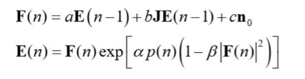

# 同じ総時間をランダム開始の「1 本の長さ」に回した比較 — G22

実験日: 2026-11-11 / グラフ: **G22**(N=2000, 辺19990) / 既知ベスト: **13359**
再現コード: `scripts/benchmarks/equal_time_pools.py --random-mode sweeps`
データ: `results/2026-11-11/equal_time_pools/v3_G22_P100_K256_m16_cim2400_T2_S500_5000_rndlong/`

---

## 1. この実験で何を試したか(一言で)

> 同じ総時間の比較で、ランダム開始に回す時間を「本数」ではなく「1 本のスイープ数」に使った。
> ランダム開始も CIM 開始と同じ 16 本にそろえ、CIM 256 回の時間ぶん 1 本の SA を長くする。
> 結果は、CIM 開始の SA が 500・5000 スイープの**どちらでもランダム開始(長い SA)が有利**($p < 0.001$)。
> 本数を増やす方向(`2026-11-10/equal_time_pools/v3`)では 500 スイープで CIM 開始が有利だったが、この方向ではそれも逆転した。

## 2. 数式の変更点

CIM・SA の更新式は変えていない(基準式のまま)。変えたのは、ランダム開始の SA の長さ(スイープ数)だけ。
SA の温度は開始 2.0 → 終了 0.001 で、長くした分だけ冷却がゆっくりになる。

## 3. 実験条件

| 項目 | 値 |
|---|---|
| 1 組(CIM 開始) | CIM 2400 周回を独立 seed で $K = 256$ 回 → 上位 16 個から SA を 1 本ずつ(500 または 5000 スイープ)。結果①と同じ 100 組・同じ seed(値を完全に再現) |
| 総時間 $T$ | $T = 256\,t_{\rm cim} + 16\,t_{\rm sa}(S)$。500:5.33 秒、5000:5.97 秒(結果④の `selection_eval` と同じ測定値) |
| ランダム開始 | 組ごとに新しいランダム解から 16 本。1 本のスイープ数 $= \lfloor S\,T / (16\,t_{\rm sa}(S)) \rfloor$:500 → **36,143**、5000 → **42,104** |
| 仮定 | SA の時間はスイープ数に比例する |
| 組数 | 100 |
| 比べる量 | 組ごとの 16 本の最良値。検定は 100 組の Mann–Whitney(両側)、差の区間は組単位のブートストラップ 95% |

## 4. 結果サマリー

| CIM 開始の SA | 条件 | 1 本のスイープ数 | BKS との差 [%] (95% 区間) | 1 本の平均の差 [%] | BKS 到達(組) |
|---|---|---|---|---|---|
| 500 | **ランダム開始** | 36,143 | **0.0061** [0.0056, 0.0067] | 0.051 | 18 |
| 500 | CIM 開始 | 500 | 0.0960 [0.0905, 0.1014] | 0.200 | 0 |
| 5000 | **ランダム開始** | 42,104 | **0.0057** [0.0051, 0.0063] | 0.046 | 24 |
| 5000 | CIM 開始 | 5000 | 0.0124 [0.0109, 0.0138] | 0.097 | 1 |

差(CIM 開始 − ランダム開始、カット値):

- 500:−12.00 [−12.75, −11.28]、$p = 8 \times 10^{-37}$
- 5000:−0.89 [−1.11, −0.69]、$p = 6 \times 10^{-16}$

## 5. 図と読み取り

図はスライド用に別途作成(`make_v29_figs.py`、`res_equal_time_rndlong_g22.png`)。

- 長く冷やしたランダム開始の SA は、**1 本の平均でも** CIM 開始より良い(5000 スイープの CIM 開始 0.097% に対し、42,104 スイープのランダム開始 0.046%)。
- 本数を増やす方向(1 本 500 スイープで 1156 本)では CIM 開始が勝っていた 500 スイープの条件でも、1 本を 36,143 スイープにすると大きく逆転する(0.260% → 0.006%)。

## 6. 考察 — 何が効いたのか

G22 では、CIM 256 回(2400 周回)の時間は、SA 16 本をそれぞれ約 3.7 万スイープ延ばせる量にあたる。
SA はゆっくり冷やすほど良い解に届くので、その時間を CIM ではなく SA の冷却に使った方が得になる。
CIM の初期解の利点(同じ長さの SA では 1 本あたり良い)は、SA を 8〜70 倍長くできる時間差を埋めるほどではない。

## 7. 注意点・今後の課題

- G22 の 1 問題だけ。
- SA の時間がスイープ数に比例するという仮定で長さを決めた(実測の 500 と 5000 スイープの時間比は 9.6)。
- CIM の周回数(2400)と回数(256)を減らせば、CIM の時間は短くなる。どこまで減らせば CIM 開始が得になるかが次の課題(今後の予定①)。
