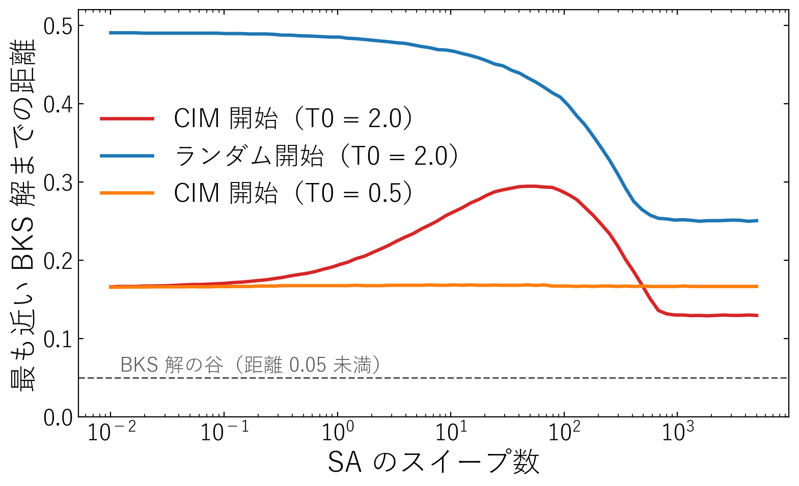
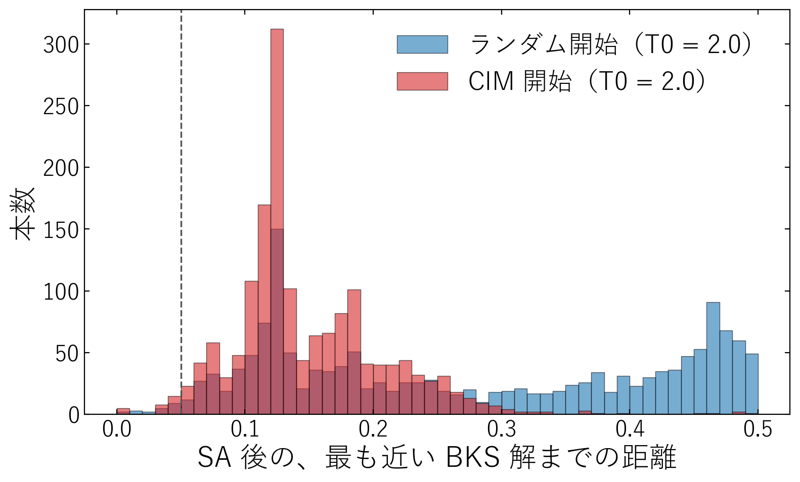
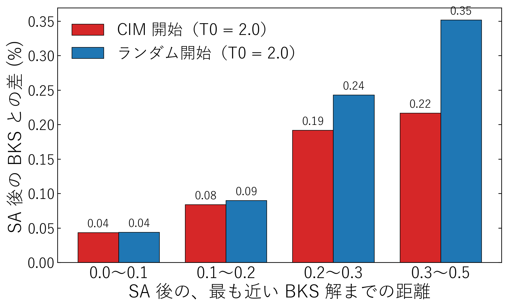

# SA の途中で解のパターンが BKS 解へどう近づくか(実験 A)— G22

実験日: 2026-11-12 / グラフ: **G22**(N=2000, 辺19990) / 既知ベスト: **13359**
再現コード: `scripts/benchmarks/sa_path_bks_distance.py`、図は `scripts/plotting/plot_start_distance.py A <このディレクトリ>`(テスト: `tests/test_start_distance_causal.py`)
データ: `results/2026-11-12/sa_path_bks_distance/v1_G22_S5000_cim_T2_random_T2_cim_T0p5/`

---

## 1. この実験で何を試したか(一言で)

> 11/9 の進捗報告で「CIM の解・ランダム解から SA で最適解に至る過程で、解のパターンがどう変わるかを統計的に見たい」と言われた。
> 結果①③と同じ開始解・同じ SA(各 1600 本)を回し直し、途中の解が **最も近い BKS 解(88 + 1 個)からどれだけ離れているか**を追った。
> **CIM 開始は高温でいったん崩れる(距離 0.17 → 0.29)が、無関係(0.5)にはならず、冷えると開始時より BKS 解の近く(0.13)に戻る。**
> ランダム開始は 45% が BKS 解と無関係な別の谷(距離 0.3 以上)に落ち、そこの解は悪い(BKS との差 0.35%)。CIM 開始で別の谷に落ちるのは 1.3%。
> **SA 後の距離が同じなら、開始解の種類によらず解の質はほぼ同じ**(距離 0.1〜0.2:CIM 開始 0.084%、ランダム開始 0.090%)。
> つまり CIM 開始の良さは「BKS 解の周りから外れない」ことでほぼ説明できる。

## 2. 数式の変更点

CIM・SA の更新式は変えていない(基準式のまま)。SA は `modules/SA.py` と乱数の消費順まで同じカーネルで、途中の解を測るだけ。

距離は、全反転を同じ解とみなした正規化ハミング距離 $d = \min(h,\, n-h)/n$($h$ は違うスピンの数、$n = 2000$)。0 は同じ解、0.5 は無関係な解。
「最も近い BKS 解までの距離」は、`bks_set_distance` v3 で集めた BKS 解 88 個と元の基準解 1 個(計 89 個、すべて 1 つの塊)の中で最も近いものとの距離。

## 3. 実験条件

| 項目 | 値 |
|---|---|
| 開始解 | 結果①③(`sa_trajectory` v3)と同じ。CIM 開始 = CIM 2400 周回 × 256 回の上位 16 個 × 独立な 100 組(1600 個)。ランダム開始 = 同じ seed のランダム解 1600 個 |
| SA | 5000 スイープ、終了温度 0.001。開始温度 $T_0$ = 2.0(CIM 開始・ランダム開始)と 0.5(CIM 開始)。seed も結果①と同じ |
| 記録 | 0.01〜5000 スイープの対数等間隔 80 点で、今の解の「最も近い BKS 解までの距離」「開始解からの距離」「カット値」「延べ反転数」。先頭 8 本はスピン全体も保存 |
| 再現の確認 | 3 条件とも、最終の最良カット値が `sa_trajectory` v3 と 1600 本すべて完全一致 |

## 4. 結果サマリー

途中の解の中央値(各 1600 本):

| スイープ | CIM 開始 $T_0$=2.0:BKS まで / 開始解から / BKS との差 | ランダム開始 $T_0$=2.0:BKS まで / 開始解から / BKS との差 | CIM 開始 $T_0$=0.5:BKS まで / 開始解から |
|---|---|---|---|
| 0 | 0.166 / 0 / 0.23% | 0.491 / 0 / 25.2% | 0.166 / 0 |
| 1 | 0.194 / 0.080 / 3.1% | 0.485 / 0.332 / 14.4% | 0.168 / 0.012 |
| 10 | 0.262 / 0.228 / 6.2% | 0.467 / 0.481 / 8.2% | 0.169 / 0.025 |
| 30 | 0.290 / 0.273 / 6.3% | 0.448 / 0.490 / 7.2% | 0.168 / 0.032 |
| 100 | 0.289 / 0.276 / 5.3% | 0.408 / 0.492 / 5.7% | 0.167 / 0.041 |
| 300 | 0.219 / 0.204 / 2.6% | 0.310 / 0.492 / 2.8% | 0.167 / 0.047 |
| 1000 | 0.130 / 0.163 / 0.25% | 0.251 / 0.492 / 0.40% | 0.167 / 0.049 |
| 5000 | **0.130** / 0.163 / 0.075% | **0.250** / 0.493 / 0.24% | **0.167** / 0.049 |

SA 後の距離ごとの割合と、BKS との差(平均):

| SA 後の距離 | CIM 開始 $T_0$=2.0:割合 / 差 | ランダム開始 $T_0$=2.0:割合 / 差 |
|---|---|---|
| 0.0〜0.1 | 14.3% / 0.043% | 9.3% / 0.044% |
| 0.1〜0.2 | 68.1% / 0.084% | 32.8% / 0.090% |
| 0.2〜0.3 | 16.3% / 0.192% | 13.0% / 0.243% |
| 0.3〜0.5 | **1.3%** / 0.217% | **44.9%** / 0.352% |
| 全体 | 100% / 0.097% | 100% / 0.223% |

SA 後の距離と BKS との差の順位相関(Spearman):CIM 開始 0.74、ランダム開始 0.84、CIM 開始 $T_0$=0.5 0.62。

## 5. 図と読み取り

- 横軸は SA のスイープ数(対数)、縦軸は今の解から最も近い BKS 解までの距離(1600 本の中央値)。
- **CIM 開始($T_0$=2.0)**:高温の間(〜100 スイープ)に距離が 0.17 → 0.29 に広がる。開始解からも 0.28 離れ、カット値は BKS との差 6% まで崩れる。それでも距離は 0.5(無関係)まで行かず、冷える 300〜1000 スイープで開始時より近い 0.13 に戻る。
- **ランダム開始**:開始解のことは 10 スイープでほぼ忘れる(開始解から 0.48)。BKS 解に近づくのは冷え始めてから(100〜1000 スイープ)で、中央値は 0.25 で止まる。
- **CIM 開始($T_0$=0.5)**:ほとんど動かない(開始解から 0.05)。BKS 解までの距離は 0.17 のままで、近づけない。
- 11/9 の報告で見えた「CIM 開始はいったん悪くなってから、最後に大きく良くなる」の中身は、**大まかな骨格を残したまま一度崩し、冷えるときに BKS 解の側へ組み直している**、ということ。

- ランダム開始の SA 後は**2 つの山**に分かれる。半分は CIM 開始と同じ 0.1〜0.2 付近に、残りの約半分(45%)は 0.45 付近(BKS 解と無関係な別の谷)に落ちる。
- CIM 開始は 0.3 より遠くに行くものがほとんどない(1.3%)。

- 同じ距離の区間で比べると、BKS との差は CIM 開始とランダム開始でほぼ同じ(0.0〜0.1:0.043% / 0.044%、0.1〜0.2:0.084% / 0.090%)。
- 遠い区間(0.2 以上)では CIM 開始の方がまだ少し良い。ただし CIM 開始でここに入るのは 18% だけ。
- つまり **「どこに着いたか」が質を決めていて、CIM 開始とランダム開始の差(0.097% vs 0.223%)は、ほとんどが「別の谷に落ちる本数の違い」** から来ている。

## 6. 考察 — 何が効いたのか

- G22 の良い解は BKS 解の周りに集まっていて、BKS 解に近いほど良い(順位相関 0.74〜0.84)。
- $T_0$ = 2.0 の SA は、開始解を全部は壊さない(開始解からの距離は最大 0.28、無関係なら 0.5)。CIM の解の「大まかな骨格」は高温の間も残り、冷えるときにその骨格のまま BKS 解の側へ仕上がる。
- ランダム解には骨格がないので、冷えるときにどの谷に入るかは運しだいで、半分近くが別の谷に落ちる。これが結果⑤の「ランダム開始はばらつきが大きい」の理由。
- $T_0$ = 0.5 では崩さないので、開始時の距離(0.17)から近づけない。これが「$T_0$ = 2.0 が良い」の理由。
- 11/9 の質問(佐々木さん)「CIM は特定の谷に集まりやすく、その谷に最適解があるのでは」に対して、G22 では **はい** と言える:BKS 解は 1 つの塊で、CIM の解はその周り(0.17)に出て、SA は高温でもそこから外れにくい。

## 7. 注意点・今後の課題

- G22 の 1 問題だけ。G55・G70 では BKS 解にほとんど届かないので、「BKS 解の代わりに何を基準にするか」から決める必要がある。
- 「SA 後の距離と質がそろう」は相関であって、距離が原因だとはまだ言えない。**開始時の距離だけを動かす介入(実験 B)で確かめる。**
  → 実験 B(`results/2026-11-12/start_distance_causal/v1_G22_S5000_T2_runs960/`)で確認済み:開始解が BKS 解から 0.3 以内なら、カット値によらず SA 後は CIM 開始と同じ質になった。
- 「BKS 解の谷(0.05 未満)」に入る本数はどの条件でも 2% 未満。SA 後の解は BKS 解そのものの塊ではなく、その周り(0.1〜0.2)の別の局所解にいる。
- なぜ CIM の解が BKS 解の周りに出るのか(CIM の式から言えるか)は、実験 C(J の最大固有ベクトルとの関係)で調べる。
