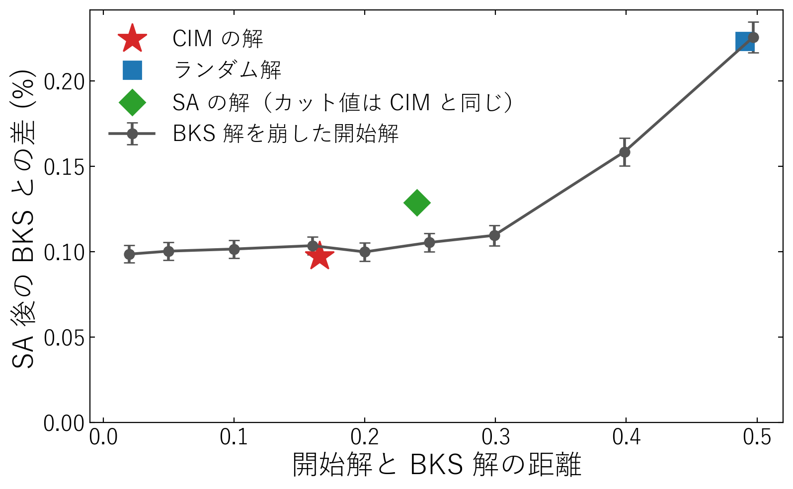
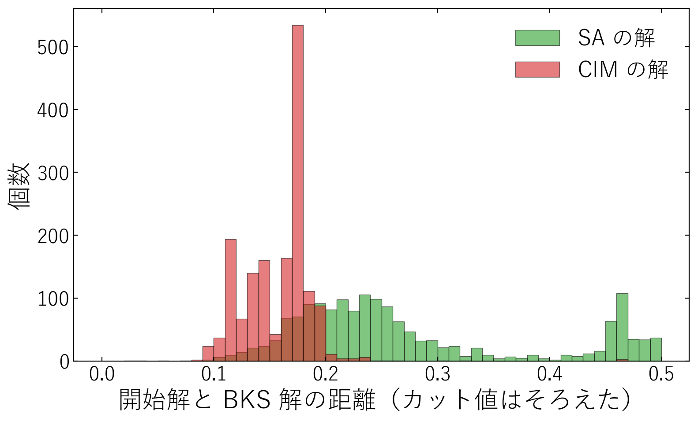
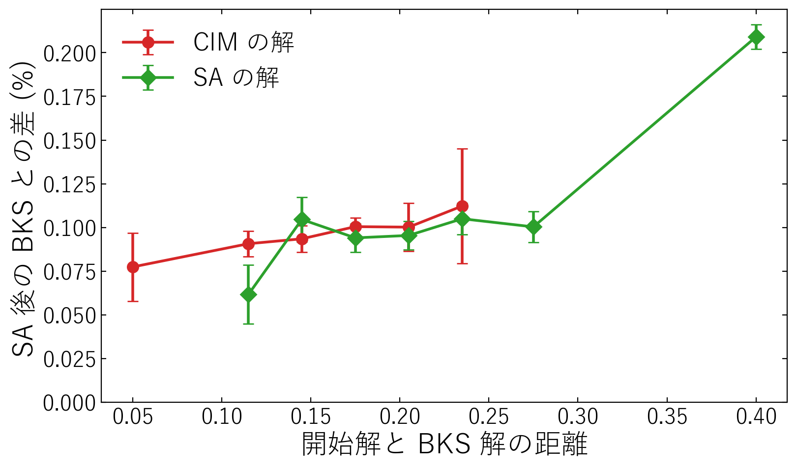

# SA の到達点は「開始解がどちらの谷にいるか」で決まる(実験 B)— G22

実験日: 2026-11-12 / グラフ: **G22**(N=2000, 辺19990) / 既知ベスト: **13359**
再現コード: `scripts/benchmarks/start_distance_causal.py`、図は `scripts/plotting/plot_start_distance.py B <このディレクトリ>`(テスト: `tests/test_start_distance_causal.py`)
データ: `results/2026-11-12/start_distance_causal/v1_G22_S5000_T2_runs960/`
前提: 実験 A(`results/2026-11-12/sa_path_bks_distance/v1_G22_S5000_cim_T2_random_T2_cim_T0p5/`)

---

## 1. この実験で何を試したか(一言で)

> 実験 A で「SA 後の質は、BKS 解からの距離でほぼ決まる」ことが見えたが、これは相関だった。開始解の距離だけを動かして、原因かどうかを確かめた。
> **B2(介入)**:BKS 解のスピンをランダムに反転して、距離 d の開始解を作った。**d が 0.02〜0.30 なら、開始時のカット値が BKS より 2〜21% も悪くても、SA 後は BKS との差 約 0.10% で一定**(CIM 開始の 0.097% と同じ)。d = 0.4 で 0.16%、d = 0.5 でランダム開始と同じ 0.23% に悪化する。
> **B1(結果②の読み直し)**:カット値を CIM の解とそろえた SA の解のうち **28% は BKS 解と無関係な谷(距離 0.3 以上)にいた**(CIM の解は 0.3%)。開始距離 0.3 未満にそろえると、**SA の解 0.098% と CIM の解 0.097% で差はない**(p = 0.53)。
> つまり、SA($T_0$ = 2.0)の到達点を決めるのは開始解のカット値ではなく、**BKS 解の側の大きな谷(半径 約 0.3)に入っているかどうか**。CIM の解の良さ(結果②の「カット値以外の良さ」)は、**ほぼ必ずこの谷の中に出ること**で説明できる。

## 2. 数式の変更点

CIM・SA の更新式は変えていない(基準式のまま)。SA は `modules/SA.py` の `simulate_sa_warm` をそのまま使った。変えたのは開始解だけ。

距離は、全反転を同じ解とみなした正規化ハミング距離 $d = \min(h,\, n-h)/n$($n = 2000$)。BKS 解は `bks_set_distance` v3 の 89 個(1 つの塊)で、「最も近い BKS 解までの距離」を使う。

## 3. 実験条件

| 項目 | 値 |
|---|---|
| SA | $T_0$ = 2.0、5000 スイープ、終了温度 0.001(結果①の CIM 開始・ランダム開始と同じ) |
| B2 の開始解 | 89 個の BKS 解を順に 1 つ選び、$k = 2000\,d$ 個のスピンをランダムに(重複なし)反転。$d$ = 0, 0.02, 0.05, 0.10, 0.16, 0.20, 0.25, 0.30, 0.40, 0.50、各 960 本 |
| B1 の開始解 | `sa_matched_start` v2 の「カット値をそろえた SA の解」1600 個を同じ seed で作り直した(カット値 1600 個すべて一致)。そこからの SA も同じ seed で回し直し、最終カット値がすべて一致することを確認 |
| 比べた相手 | CIM 開始(`sa_trajectory` v3 の `cim_T2`、1600 本)、ランダム開始(`random_T2`、1600 本) |

## 4. 結果サマリー

**B2:BKS 解から距離 d だけ崩した開始解**(各 960 本、± は 95% 区間)

| d | 開始時の BKS との差 | SA 後の BKS との差 | SA 後の距離(中央値) | SA 後に 0.3 より遠い割合 |
|---|---|---|---|---|
| 0.02 | 2.0% | 0.099 ± 0.005% | 0.129 | 1.5% |
| 0.05 | 4.8% | 0.100 ± 0.005% | 0.128 | 1.5% |
| 0.10 | 9.1% | 0.102 ± 0.005% | 0.129 | 1.7% |
| 0.16 | 13.6% | 0.104 ± 0.005% | 0.129 | 1.9% |
| 0.20 | 16.1% | 0.100 ± 0.005% | 0.128 | 2.1% |
| 0.25 | 18.9% | 0.105 ± 0.005% | 0.128 | 2.7% |
| 0.30 | 21.2% | 0.110 ± 0.006% | 0.129 | 4.9% |
| 0.40 | 24.2% | 0.158 ± 0.008% | 0.157 | 19.5% |
| 0.50 | 25.2% | 0.226 ± 0.009% | 0.257 | 44.4% |
| (参考)CIM の解(d 中央値 0.166) | 0.22% | 0.097% | 0.130 | 1.3% |
| (参考)ランダム解(0.49) | 25.2% | 0.223% | 0.250 | 44.9% |

$d$ = 0(BKS 解そのもの)は、SA が開始解も含めた最良値を返すため自明に 0% になるので、表と図から除いた。

**B1:カット値をそろえた開始解(CIM の解 vs SA の解、各 1600 個)**

| | CIM の解 | SA の解 |
|---|---|---|
| 開始時の BKS との差 | 0.218% | 0.218%(98.8% が同じカット値) |
| 開始時の距離(中央値) | 0.166 | 0.240 |
| 開始時に 0.3 より遠い割合 | **0.3%** | **27.6%** |
| SA 後の BKS との差(全体) | 0.097% | 0.129% |
| SA 後の BKS との差(開始距離 0.3 未満だけ) | 0.097 ± 0.004%(1595 個) | 0.098 ± 0.004%(1159 個)、Mann–Whitney p = 0.53 |
| SA 後の BKS との差(開始距離 0.3 以上) | —(5 個) | 0.209%(441 個) |

## 5. 図と読み取り

- 灰色の線:BKS 解を d だけ崩した開始解から SA を回した結果。**d = 0.3 までは平ら**で、開始時のカット値がどれだけ悪くても(最大 21%)、SA 後は CIM 開始(赤い星)と同じ約 0.10% になる。
- d = 0.4 から悪くなり、d = 0.5 でランダム開始(青い四角)と重なる。
- 緑のひし形(カット値をそろえた SA の解)は、平均の距離は 0.24 だが、無関係な谷にいる 28% が平均を押し上げている(下の 2 枚)。

- カット値は同じでも、**SA の解は 2 つの山**に分かれる。約 7 割は CIM の解と同じ側(0.1〜0.3)、約 3 割は BKS 解と無関係な谷(0.45〜0.5)。
- **CIM の解は 0.3 より遠いものがほとんどない(1600 個中 5 個)**。カット値だけ見ても、どちらの谷の解かは分からない。

- 同じ距離で比べると、CIM の解と SA の解の SA 後の質は重なる(0.1〜0.3 で約 0.09〜0.11%)。差が出るのは 0.3 以上(右端の点、SA の解だけ)で、0.21% と悪い。

## 6. 考察 — 何が効いたのか

- G22 の解空間には、大まかに **BKS 解の側の大きな谷**(BKS 解から半径 約 0.3)と、**BKS 解と無関係な別の谷**(BKS 解から 0.45〜0.5)がある。
- $T_0$ = 2.0 の SA は、大きな谷の中ならどこから始めても同じ所(BKS 解から 0.13 付近、BKS との差 約 0.10%)まで仕上げる。開始時のカット値はほとんど関係ない(B2:21% 悪くても同じ)。実験 A で見た「高温でいったん崩す(CIM 開始で 0.29 まで離れる)」の範囲が、ちょうどこの谷の大きさに収まっている。
- 別の谷から始めると、そこから抜けられず悪い解(約 0.2〜0.35%)で終わる。ランダム解は約半分、SA の解(カット値は CIM と同じ)は約 3 割がこちらにいる。
- **CIM の解はほぼ必ず大きな谷の中に出る**(1600 個中 1595 個)。これが「CIM → SA」が良い理由で、結果②の「同じカット値でも CIM の解の方が良い」の正体でもある。カット値という 1 つの数では見えない、解の「位置」の情報を CIM の解は持っている。
- 11/9 の議論との対応:「CIM は特定の谷に集まりやすく、その谷に最適解がある」(佐々木さん)は G22 で成り立つ。SA は高温で揺らしても谷から出ないので、谷の中で仕上げる役に向いている。

## 7. 注意点・今後の課題

- G22 の 1 問題だけ。G55・G70 で同じ「2 つの谷」の構造があるか、CIM の解がいつも BKS 側の谷に出るかは未確認。
- B2 の崩し方はランダムな反転なので、CIM の解の「ずれ方」(おそらく構造を持つ)とは違う。それでも同じ結果になるのは、高温の SA がランダムなずれをすぐ消すためと考えられる。
- 谷の大きさ(約 0.3)は $T_0$ = 2.0 の場合。開始温度を変えると変わるはずで、$T_0$ と谷の大きさの関係は未確認。
- B1 の直線回帰(summary.json の `ols_*`)は、関係がしきい値型なので当てはまらない。比較には上の「開始距離 0.3 未満」の比較を使う。
- 次:なぜ CIM の解がこの谷に出るのか(実験 C:CIM の線形増幅段で育つ J の最大固有ベクトルと、BKS 解の谷との関係)。
