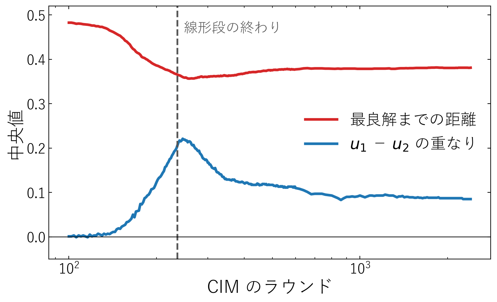
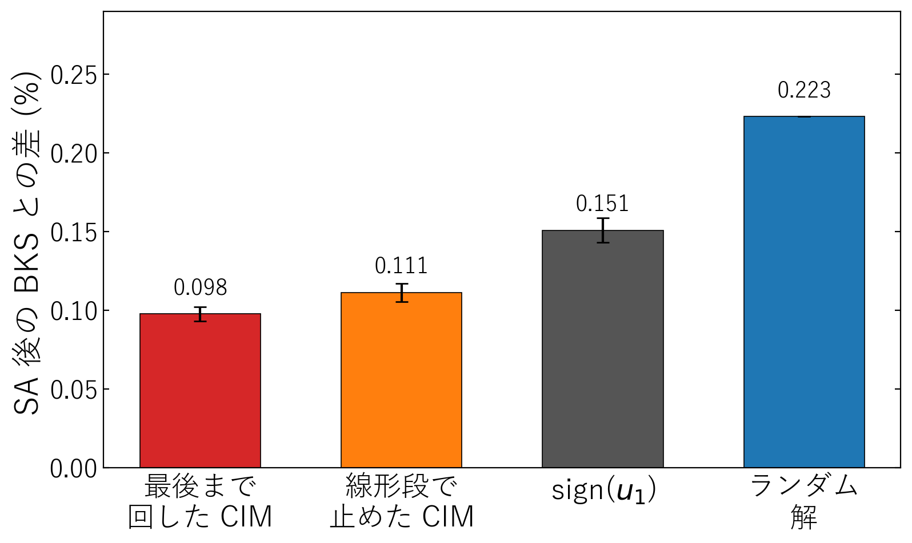
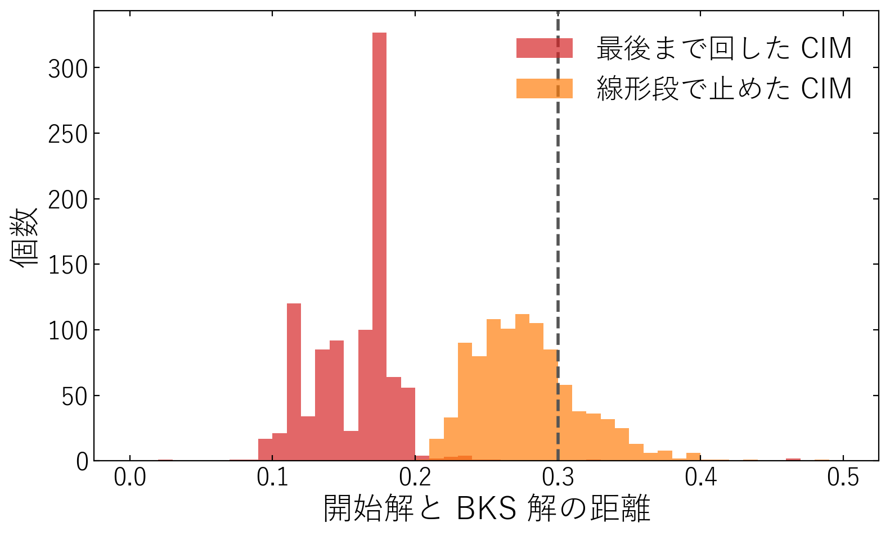

# CIM の線形段は u1 の側を選ぶが、非線形段が谷の奥へ運ぶ効果は小さい(実験 D)— G22

実験日: 2026-11-14 / グラフ: **G22**(N=2000, 辺19990) / 既知ベスト: **13359**
事前登録: `docs/20261114/prereg_cim_stage_v1.md`(実験を回す前に書いた。予測 P1〜P3 の合否はこれで決めた)
再現コード: `scripts/benchmarks/cim_stage_valley.py`、図は `scripts/plotting/plot_cim_stage_valley.py <このディレクトリ> [slide]`(テスト: `tests/test_cim_stage_valley.py`)
データ: `results/2026-11-14/cim_stage_valley/v2_G22_D1P4_D2P60_sat0.01/`
前提: 実験 B(`results/2026-11-12/start_distance_causal/v1_…`)、実験 C(`results/2026-11-13/eigvec_valley/v1_…`)

---

## 1. この実験で何を試したか(一言で)

> 実験 C から「CIM の**線形段**(振幅が小さく、行列をかけるだけの間)が J の最大固有ベクトル $u_1$ の側の谷を選び、**非線形段**(利得が飽和してから)が解を谷の奥へ運ぶ」という考えが出た。これを、CIM の途中の状態を記録して確かめた。
> **D1(観察、CIM 1024 本)**:線形段の終わりで、解は $u_1$ の側に寄っていた(E の中央値 +0.21)。**予測 P1 は当たった。** しかし非線形段で最良解に近づくことはなく(距離の中央値 0.365 → 0.381)、$u_1$ への寄りも弱まった(E +0.21 → +0.085)。**予測 P2 は外れた。** CIM 1 本ずつで見ると、**68% は最良解の谷の外(距離 0.3 以上)で終わる。**
> **D2(介入、SA の開始に使った 960 本)**:同じ seed の CIM を線形段の終わりで止めて SA で仕上げると 0.111%。最後まで回すと 0.098%。差は 0.014% で、事前に決めた基準(p < 0.01)を満たさなかった(p = 0.014)。**予測 P3 も外れた。**
> つまり、これまで「CIM の解は 99.7% が谷の中」と言ってきたのは、**256 本からカット値の上位 16 本を選んだ解**の話だった。CIM 1 本の動きとしては「線形段が $u_1$ の側へ向ける」までは言えるが、「非線形段が谷の奥へ運ぶ」は G22 では支持されなかった。**谷の中に入るのは、カット値で上位を選ぶ段階の効果が大きい。**

## 2. 数式の変更点

CIM・SA の更新式は変えていない(基準式のまま)。CIM は `modules/CIM.py` の `_simulate_cim_trajectory`(`run_cim` と同じ乱数列。全 1024 本で最良カット値が一致することを確かめた)で、途中の振幅 $c$ を記録しただけ。

- 飽和度 $s(k) = \gamma \cdot \mathrm{mean}_i\,(\sqrt{\eta}\,c_i + (Jc)_i)^2$。利得の指数が $\gamma I_{\mathrm{in}}$ の割合だけ下がる量。
- **線形段の終わり** $k_{\mathrm{lin}}$:試行ごとに、$s$ が初めて 0.01 以上になったラウンド(0〜600 ラウンドは 2 ラウンドおきに記録)。
- 距離 $d$:sign($c$) と最も近い BKS 解(89 個)との正規化ハミング距離。谷の中 = $d$ < 0.3。重なり $\mathrm{ov}_k$ と $E = \mathrm{ov}_1 - \mathrm{ov}_2$ は実験 C と同じ。

## 3. 実験条件

| 項目 | 値 |
|---|---|
| CIM | G22 の調整済みパラメータ、2400 ラウンド(sa_trajectory v3 と同じ) |
| D1 | seed 1000〜2023 の 1024 本(プール 0〜3 の全部)。0〜600 ラウンドは 2 ラウンドおき、その後は 20 ラウンドおきに記録 |
| D2 | sa_trajectory v3 の CIM 開始解と同じ 960 本(プール 0〜59 のカット値上位 16 本、解が一致することを確認)。同じ seed で $k_{\mathrm{lin}}$ まで回し、そのときの sign($c$) から SA($T_0$ = 2.0、5000 スイープ、seed 150,000,000 台) |
| 比べた相手 | 同じ 960 本の CIM の解(最後まで回したもの)からの SA(sa_trajectory v3 の cim_T2、同じ条件) |

## 4. 結果サマリー

**予測の合否**

| 予測 | 基準 | 結果 | 合否 |
|---|---|---|---|
| P1 線形段が $u_1$ 側を選ぶ | $k_{\mathrm{lin}}$ で E の中央値 > 0、$d$ の中央値 0.25〜0.40 | E +0.210、$d$ 0.365 | **当たり** |
| P2 非線形段が奥へ運ぶ | $d$ の中央値が 0.05 以上下がる、E > 0 のまま | $d$ 0.365 → 0.381(0.016 上がる)、E +0.085 | **外れ** |
| P3 止めると悪くなる | 対応のある Wilcoxon p < 0.01、平均 0.12〜0.20% | 0.111% vs 0.098%、p = 0.014 | **外れ** |

**D1:CIM の途中(1024 本の中央値)**

| ラウンド | 飽和度 | 最良解までの距離 | E | 谷の外の割合 | 上位 10 本の固有ベクトルの重み |
|---|---|---|---|---|---|
| 100 | 0.0000 | 0.482 | +0.001 | 100% | 0.04 |
| 150 | 0.0000 | 0.453 | +0.018 | 100% | 0.35 |
| 200 | 0.0000 | 0.386 | +0.123 | 87% | 0.96 |
| 236($k_{\mathrm{lin}}$ の中央値) | 0.01 | **0.365** | **+0.210** | 80% | 0.99 |
| 300 | 0.18 | 0.361 | +0.167 | 69% | 0.79 |
| 600 | 0.34 | 0.377 | +0.110 | 67% | 0.58 |
| 2399(最後) | 0.62 | **0.381** | **+0.085** | **68%** | 0.34 |

最良カット値の解(CIM が返す解)でも、距離の中央値 0.379、谷の外 68%。

**D2:線形段で止めた解 vs 最後まで回した解(同じ 960 本)**

| | 線形段で止めた CIM | 最後まで回した CIM |
|---|---|---|
| 開始時の BKS との差(平均) | 5.29% | 0.22% |
| 開始時の距離(中央値) | 0.274 | 0.167 |
| 開始時に谷の外の割合 | 23.8% | 0.3% |
| SA 後の BKS との差(平均 ± 95% 区間) | **0.111 ± 0.006%** | **0.098 ± 0.005%** |
| SA 後に谷の外の割合 | 5.0% | —(実験 A:1.3%) |

対応のある Wilcoxon 検定 p = 0.014(差の中央値は 0)。参考:sign($u_1$) から 0.151%、ランダム解から 0.223%(実験 C)。

## 5. 図と読み取り

- 赤:最良解までの距離。線形段(ラウンド 236 まで)で 0.48 から 0.365 まで下がる。そのあとはほとんど動かず、少し離れる(0.381)。
- 青:$u_1$ と $u_2$ の重なりの差 E。線形段の終わりで最大(+0.21)になり、飽和が進むと +0.085 まで下がる。**$u_1$ の側へ向けるのは線形段で、非線形段はむしろそれを弱める。**
- 線形段の終わりでは、上位 10 本の固有ベクトルが振幅の 99% を占める(実験 C の予測の前提どおり)。

- SA の開始に使ってきた 960 本でも、線形段で止めると 0.111% で、最後まで回した 0.098% との差は小さい。sign($u_1$)(0.151%)よりずっと良い。
- 止めた解のカット値は 5% も悪いが、距離は 0.274(谷の中が 76%)。**SA で仕上げると、カット値の差は消え、谷の中にいるかどうかがほぼ決める**(実験 B と同じ)。

- この 960 本では、非線形段のあいだに距離が 0.274 → 0.167 と縮んでいる。しかし D1 の全 1024 本では縮んでいない。**最後のカット値で上位 16 本を選ぶと、非線形段で最良解に近づいた試行が選ばれる**ため、この縮みは選び方の結果と考えられる。

## 6. 考察 — 何が効いたのか

- **線形段**:予測どおり、J の上位の固有ベクトルが育ち、sign($c$) は $u_1$ の側に寄る(E +0.21)。ただし CIM 1 本ずつのばらつきは大きく(E の四分位 −0.14〜+0.49)、線形段の終わりで谷の中にいるのは 20% だけ。
- **非線形段**:CIM 1 本の動きとしては、最良解に近づけない。$u_1$ への寄りも弱まる。「非線形段が谷の奥へ運ぶ」という考えは、G22 では支持されなかった。
- **カット値で上位を選ぶ段階**:CIM 1 本だと 68% が谷の外で終わるが、256 本の上位 16 本では 0.3% だけ。**「CIM の解は谷の中」は、CIM を何本も回して良いものを選ぶ使い方とセットの性質**だった。一方で、カット値をそろえた SA の解は 28% が谷の外にいた(実験 B)。カット値で選んだときに谷の中のものが残りやすいのは、CIM の解の方。
- これまでの言い方の訂正:「CIM の解は 99.7% が最良解の谷の中」は、「**カット値上位 16/256 に選んだ** CIM の解は 99.7% が谷の中」と書く必要がある。

## 7. 注意点・今後の課題

- G22 の 1 問題だけ。
- 事前登録のあと、本番の前に小さな試し(D1 256 本、D2 16 本)を回して数を見ている。予測と基準は書き換えていない。
- 線形段の終わりの定義(飽和度 0.01)は 1 本の振幅を見て決めた。0.001 や 0.05 にしたときに結論が変わるかは未確認。
- D2 は「最後まで回したときのカット値で選んだ 960 本」を途中で止めたもので、CIM を使わない方法ではない。線形段で止めた解の中から(止めたときのカット値で)上位を選ぶ方法との比較は未実施。
- 次:CIM 1 本ずつが谷の中で終わるかを分けるもの(線形段の終わりの E、ノイズ)を調べる。カット値で選ぶ段階がなぜ谷の中の解を残すのか(谷の中と外でカット値の分布がどう違うか)を見る。
