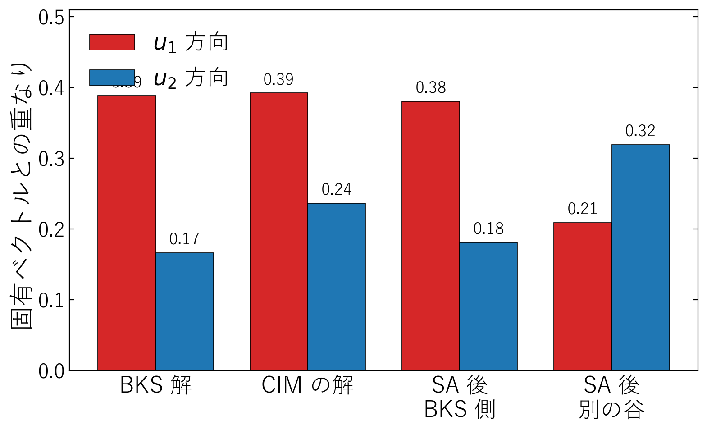
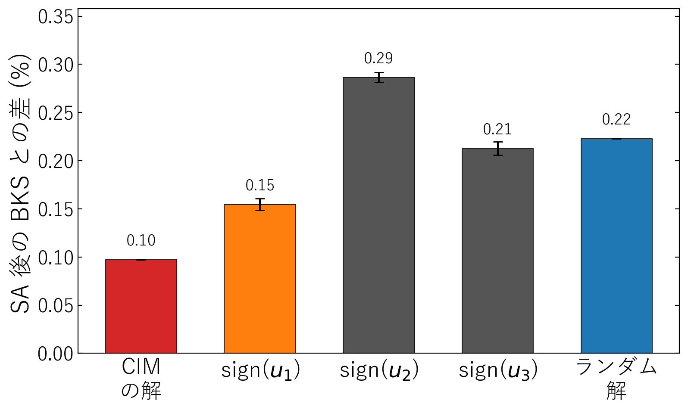

# BKS 解側の谷は J の最大固有ベクトル u1 の側にある(実験 C)— G22

実験日: 2026-11-15(v1 は 2026-11-13、C2 は各 960 本)/ グラフ: **G22**(N=2000, 辺19990) / 既知ベスト: **13359**
再現コード: `scripts/benchmarks/eigvec_valley.py`、図は `scripts/plotting/plot_eigvec_valley.py <このディレクトリ> [slide]`(テスト: `tests/test_eigvec_valley.py`)
データ: `results/2026-11-15/eigvec_valley/v1_G22_S5000_T2_runs1600/`
11-13 の run からの変更: C2 の本数を各 960 → **1600 本**にした(CIM 開始・ランダム開始の 1600 本とそろえるため)。C1 は同じ 1600 個で、数値は変わらない。SA は高速化した `modules/SA.py`(結果は高速化前と 1 ビットも同じ。`tests/test_sa_warm_fast_equiv.py`、C1 で CIM・ランダム開始の最終カット値 1600 個ずつが一致)。
前提: 実験 A(`results/2026-11-12/sa_path_bks_distance/v1_…`)、実験 B(`results/2026-11-12/start_distance_causal/v1_…`)

---

## 1. この実験で何を試したか(一言で)

> 実験 B で「SA 後の質は、開始解が BKS 解側の谷(BKS 解から 0.3 以内)にいるかで決まり、CIM の解はほぼ必ずこの谷に出る」ことが分かった。
> 11/9 の指摘「思いつきでなく本質であることを示す」に答えるため、**なぜ CIM の解がこの谷に出るのかを、CIM の式から予測して確かめた。**
> **予測**:飽和前の CIM は線形写像なので、J の最大固有値の固有ベクトル $u_1$ の方向が一番速く育つ。だから BKS 解側の谷は $u_1$ の側、別の谷は別の固有ベクトルの側にあるはず。
> **C1(位置)**:BKS 側の谷の解は $u_1$ に、別の谷の解は $u_2$ に寄っていた(ランダム開始 SA の解で AUC 0.88、カット値をそろえた SA の解で 0.89)。
> **C2(CIM を使わない対照)**:スペクトル緩和の解 sign($u_1$) から SA を回すと 0.155%。sign($u_2$)(0.286%)・ランダム解(0.223%)より良いが、CIM の解(0.097%)には届かない。
> つまり **CIM の良さの一部は「$u_1$ 側の谷を選ぶ」ことで説明でき、残りは CIM の非線形の部分が谷の奥(BKS 解から 0.17)に解を置くことによる。**

## 2. 数式の変更点

CIM・SA の更新式は変えていない(基準式のまま)。

予測の根拠:振幅が小さい間の CIM は $c_{k+1} \approx e^{g_0/2}(\sqrt{\eta}\,I + J)c_k + \xi$ という線形写像になる。$\sqrt{\eta} I$ は全モードを同じだけ持ち上げるので、一番速く育つのは $J$ の最大固有値の固有ベクトル $u_1$(2026-08-23 `cim_diversity_ablation` v3 §5.5 と同じ議論)。

重なり:$\mathrm{ov}_k(s) = |\langle s, \mathrm{sign}(u_k)\rangle| / n$(全反転で変わらない、0〜1)。$E = \mathrm{ov}_1 - \mathrm{ov}_2$ は 10/18 の事前登録(`docs/20261018/prereg_eigen_v1.md`)と同じ定義。谷は「最も近い BKS 解までの距離」(実験 A・B と同じ)が 0.3 未満か以上かで分けた。

## 3. 実験条件

| 項目 | 値 |
|---|---|
| 固有ベクトル | $J$(CIM の結合)の大きい方から 10 本(`eigsh`、which="LA")。固有値 0.4505, 0.4475, 0.4450, …(上位がほぼ縮退) |
| C1 の解 | BKS 解 89 個、CIM の解 1600 個(結果①と同じ)、CIM 開始・ランダム開始の SA 後の解 各 1600 個(結果①と同じ seed で回し直し、最終カット値がすべて一致)、カット値をそろえた SA の解 1600 個(結果②と同じ seed で作り直し、カット値がすべて一致) |
| C2 の SA | 開始解 sign($u_1$)・sign($u_2$)・sign($u_3$) から、$T_0$ = 2.0、5000 スイープ、終了温度 0.001、各 1600 本(seed 140,000,000 台) |

## 4. 結果サマリー

**C1:固有ベクトルとの重なり(平均)**

| 解 | 個数 | $\mathrm{ov}_1$ | $\mathrm{ov}_2$ | 別の谷の割合 | E(BKS 側 / 別の谷) | 谷の判別 AUC |
|---|---|---|---|---|---|---|
| BKS 解 | 89 | 0.388 | 0.166 | 0% | +0.222 / — | — |
| CIM の解 | 1600 | 0.392 | 0.237 | 0.3% | +0.157 / −0.295(5 個) | 1.00 |
| CIM 開始 SA 後 | 1600 | 0.386 | 0.194 | 0.3% | +0.194 / −0.293(5 個) | 1.00 |
| ランダム解 | 1600 | 0.017 | 0.018 | 100% | — | — |
| ランダム開始 SA 後 | 1600 | 0.303 | 0.243 | 45.0% | **+0.199 / −0.110** | **0.88** |
| カット値をそろえた SA の解 | 1600 | 0.291 | 0.251 | 27.6% | **+0.154 / −0.257** | **0.89** |

ランダム開始 SA 後の内訳:BKS 側(880 本)は $\mathrm{ov}_1$ 0.380 / $\mathrm{ov}_2$ 0.181、別の谷(720 本)は 0.209 / 0.319。

**C2:スペクトル緩和の解から SA(各 1600 本、± は 95% 区間)**

| 開始解 | 開始時の BKS との差 | 開始時の BKS 解までの距離 | SA 後の BKS との差 | SA 後に別の谷にいる割合 |
|---|---|---|---|---|
| sign($u_1$) | 4.90% | 0.303 | **0.155 ± 0.006%** | 19.5% |
| sign($u_2$) | 4.51% | 0.414 | 0.286 ± 0.005% | 77.2% |
| sign($u_3$) | 4.78% | 0.368 | 0.213 ± 0.007% | 37.4% |
| (参考)CIM の解 | 0.22% | 0.166(中央値) | 0.097% | 0.3% |
| (参考)ランダム解 | 25.2% | 0.49 | 0.223% | 45.0% |

## 5. 図と読み取り

- BKS 解・CIM の解・BKS 側の谷に入った SA 後の解は、どれも $u_1$ との重なり(赤)が約 0.39 で、$u_2$(青)より大きい。
- 別の谷に落ちた SA 後の解は逆に $u_2$ の方が大きい(0.32 vs 0.21)。**2 つの谷は、$u_1$ 側と $u_2$ 側に対応している。**
- CIM の解はランダムな解(重なり 0.02)とは違い、最初から $u_1$ 側にある。

- CIM を使わずに sign($u_1$) から始めても、SA 後は 0.155% で、ランダム開始(0.22%)より良い。sign($u_2$) から始めると 77% が別の谷に落ち、0.29% と一番悪い。**$u_1$ 側を選ぶこと自体に効果がある。**
- ただし CIM の解(0.097%)には届かない。sign($u_1$) は BKS 解から 0.30(谷の縁)にあり、20% が別の谷に落ちる。CIM の解は 0.17(谷の奥)にあり、別の谷に落ちるのは 0.3%。

## 6. 考察 — 何が効いたのか

- CIM → SA の役割分担は、最適化の「連続緩和で大まかな位置を決め、離散の局所探索で仕上げる」という 2 段構えとして説明できる。
  - **CIM**:線形段で $J$ の上位固有ベクトル(特に $u_1$)を育て、非線形段で ±1 に丸める。その結果、解は $u_1$ 側の谷(= BKS 解側の谷)の奥に出る(C1、実験 B)。
  - **SA**($T_0$ = 2.0):谷の中ならどこから始めても同じ所まで仕上げる(実験 B2)。谷は越えにくい。
- 予測(CIM の式から $u_1$ 側)は、C1・C2 の両方で支持された。10/18 の事前登録で「E が SA 後の質を予測する」(ρ = 0.56、G22)ことは確認済みで、今回はその理由(E の正負が谷に対応する)が分かった。
- ただし $u_1$ だけでは CIM の解の良さ(0.097%)を説明しきれない(sign($u_1$) は 0.155%)。上位の固有値はほぼ縮退(0.4505, 0.4475, 0.4450 …)していて、CIM の解は $u_1$ だけでなく $u_3$ などとも重なる(探索的に見た $|\cos|$:$u_1$ 0.45、$u_2$ 0.28、$u_3$ 0.29)。CIM の非線形の部分が、上位の固有ベクトルを組み合わせて谷の奥に解を置いていると考えられる。

## 7. 注意点・今後の課題

- G22 の 1 問題だけ。10/18 の事前登録では G55・G70 で E が効かなかった(SA が開始解から 0.43〜0.44 離れ、開始解の差が消える)。谷の構造が問題ごとにどう違うかは未確認。
- 予測を立てる前に、ランダム開始 SA の解 8 本だけを探索的に見ている(別の谷の解が $u_2$ に寄っているのを見た)。本数・判定は見る前に決めていないので、C1 は「予測と整合する」までの主張にとどめる。C2 は見る前に設計した。
- sign($u_1$) と CIM の差(0.155% vs 0.097%)を生む非線形の役割は未確認。次の候補:CIM の途中(線形段 → 飽和)の状態の $u_1, u_2, u_3$ 成分の推移を追う、上位 k 本の固有ベクトルの組み合わせから始めた SA と比べる。
