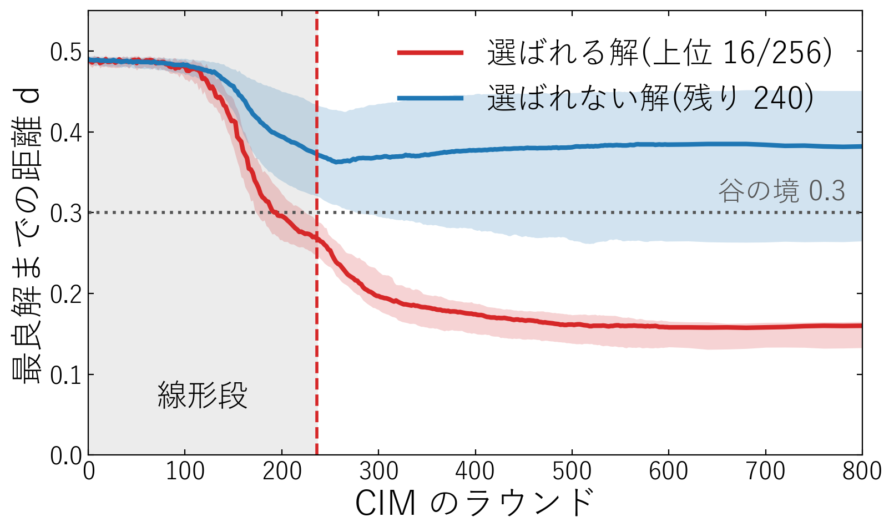
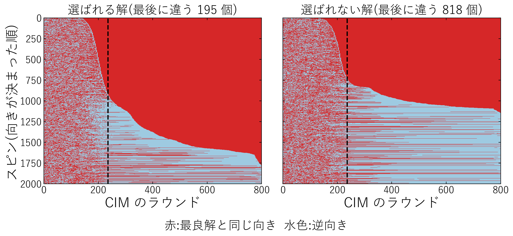

# 選ばれる CIM の解は、線形段の後半に最良解の谷へ入り、非線形段の初めに谷の奥へ寄る(実験 F)— G22

実験日: 2026-11-16 / グラフ: **G22**(N=2000, 辺 19990) / 既知ベスト: **13359**
再現コード: `scripts/benchmarks/cim_bks_approach.py`、図は `scripts/plotting/plot_cim_bks_approach.py <このディレクトリ> [slide]`
データ: `results/2026-11-16/cim_bks_approach/v1_G22_D1P4/`
前提: 実験 D(`results/2026-11-15/cim_stage_valley/v1_G22_D1P4_D2P100_sat0.01/`)の D1(1024 本の途中経過)

---

## 1. この実験で何を試したか(一言で)

> 11/16 の進捗報告会で「G22 の最適パターンに、CIM がどう近づくかを見たい」と言われた。
> 実験 D では 1024 本**全体**の中央値しか見ておらず、「非線形段で最良解に近づかない(0.365 → 0.381)」と書いた。
> しかし実際に SA に渡すのは、256 本から**カット値上位 16 本を選んだ解**である。そこで 2 つに分けて、ラウンドごとの距離を見た。
> **結果**:選ばれる解は、線形段の後半(ラウンド 150〜236)に d 0.49 → 0.27 と谷に入り、非線形段の初め(〜400)に 0.17 まで寄って、その後は動かない。
> 選ばれない解は 0.37 前後で止まり、谷の外(0.3 以上)に残るものが 73%。**谷に入るかどうかは、線形段の終わりまでにほぼ分かれている。**

## 2. 数式の変更点

なし(CIM・距離の定義は実験 D と同じ)。

## 3. 実験条件

| 項目 | 値 |
|---|---|
| 元データ | 実験 D の D1:CIM 256 本 × 4 プール(seed 1000〜2023、2400 ラウンド)の途中の sign(c) と、最も近い BKS 解(89 個)までの距離 d |
| 分け方 | 各プールで最後のカット値の上位 16 本を「選ばれる解」(計 64 本)、残り 240 本を「選ばれない解」(計 960 本)。カット値は `run_cim` で同じ seed から作り直した |
| 1 本ずつの記録(F2) | 選ばれる解のうちカット値が最大の 1 本(seed 1707、13346)と、選ばれない解のうちカット値が中央の 1 本(seed 1965、13291)の、全スピンの振幅 |
| 谷 | 最も近い BKS 解までの距離 d < 0.3(検証1 で決めた境) |

## 4. 結果サマリー

| ラウンド | 選ばれる解 d(中央値) | 谷の中 | 選ばれない解 d | 谷の中 |
|---|---|---|---|---|
| 0 | 0.490 | 0% | 0.490 | 0% |
| 100 | 0.481 | 0% | 0.482 | 0% |
| 200 | 0.296 | 55% | 0.394 | 10% |
| 236(線形段の終わり) | 0.268 | 80% | 0.373 | 16% |
| 300 | 0.197 | 98% | 0.368 | 27% |
| 400 | 0.174 | 100% | 0.377 | 28% |
| 2399(最後) | 0.166 | 100% | 0.384 | 27% |

## 5. 図と読み取り

- 2 つの群はラウンド 150 ごろから分かれ、線形段の終わり(236)で既に 0.27 と 0.37。
- 選ばれる解は、非線形段の初め(236〜400)にさらに 0.27 → 0.17 と寄る。400 以降はほぼ動かない。
- 選ばれない解は 0.37〜0.38 で止まる。

- 選ばれる解では、2000 スピンのうち約 900 個がラウンド 236 までに最良解と同じ向きで固まり、残りの多くが 236〜800 に順に固まる。最後まで違うのは 195 個(d = 0.098)。
- 選ばれない解では、線形段の終わりまでに固まる数が少なく、最後まで 818 個が逆向き。

## 6. 考察 — 何が効いたのか

- 実験 D の「非線形段で最良解に近づかない」は、1024 本全体の中央値の話だった。全体の 94% は選ばれない解で、これが止まっているため中央値は動かない。
- 選ばれる解だけを見ると、非線形段の初めにも 0.27 → 0.17 と近づいている。CIM は「線形段で谷の入口まで来た解」を、非線形段で谷の奥へ運んでいる。
- ただし、「選ばれる」は最後のカット値で決めているので、非線形段で近づいた試行が選ばれやすい(選び方による偏り)。非線形段そのものの効果と、選び方の効果は、この実験だけでは分けられない。

## 7. 今後

- 線形段の終わりの時点で、選ばれる解を予測できるか(その時点の E やカット値で選ぶ)。予測できれば、CIM を途中で止めて選ぶことができる。
- 他の問題(G55・G70)で同じ図を描く(実験 E)。
