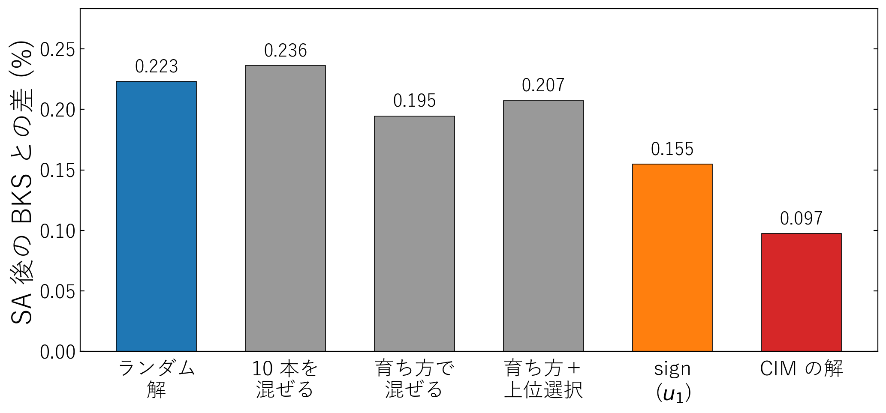

# 固有ベクトルをランダムに混ぜた解からの SA は、CIM の解からの SA に届かない(実験 G)— G22

実験日: 2026-11-16 / グラフ: **G22**(N=2000, 辺 19990) / 既知ベスト: **13359**
再現コード: `scripts/benchmarks/eigmix_start.py [--runs 1600] [--select]`、図は `scripts/plotting/plot_eigmix_start.py <この run> <--select の run> [slide]`
データ: `results/2026-11-16/eigmix_start/v2_G22_runs1600/`(混ぜるだけ)、`v3_G22_runs1600_select/`(256 本から上位 16 本を選ぶ)
比べる値: CIM の解・ランダム解は実験 C(`2026-11-15/eigvec_valley/v1_…`)、線形段で止めた CIM は実験 D(`2026-11-15/cim_stage_valley/v1_…`)

---

## 1. この実験で何を試したか(一言で)

> 11/16 の進捗報告会で教授から「CIM の良さが固有値の大きいベクトルで決まるなら、固有値の大きいベクトルのセット(5〜10 個)を
> 数学的にランダムに作って SA に入れればよく、CIM でなくてもよいかもしれない」という案が出た。これを試した。
> **結果**:どの混ぜ方でも SA 後は 0.195〜0.236% で、ランダム解(0.223%)と大差なく、sign($u_1$) 1 本(0.155%)より悪い。
> CIM と同じく 256 本から上位 16 本を選んでも 0.207%。開始時に谷の中にいるのは 38% で、CIM の解(99.7%)に遠く及ばない。
> **固有ベクトルの組を作るだけでは CIM の代わりにならない。** CIM の解が谷の奥にいるのは、線形段の後の非線形の動き(実験 F)による。

## 2. 数式の変更点

開始解 $s = \mathrm{sign}\left(\sum_{k=1}^{K} w_k g_k u_k\right)$、$g_k \sim \mathcal{N}(0, 1)$(1 本ごとに引き直す)、$u_k$ は $J$ の固有値の大きい順の固有ベクトル。

- 等しく混ぜる:$w_k = 1$、$K$ = 1, 5, 10, 50
- 育ち方で混ぜる:$w_k = e^{\tau(\lambda_k - \lambda_1)}$、$K$ = 50。CIM の線形段では各モードが $(\sqrt{\eta} + \lambda_k)^n$ に比例して育つので、
  $n = 236$(線形段の終わりの中央値)での比 $((\sqrt{\eta} + \lambda_k)/(\sqrt{\eta} + \lambda_1))^{236}$ に最小二乗で合わせて $\tau$ を決めた。

CIM・SA の更新式は変えていない。

## 3. 実験条件

| 項目 | 値 |
|---|---|
| 本数 | 各条件 1600 本 |
| 上位選択(`--select`) | 256 本作り、カット値上位 16 本を残す × 100 組 |
| SA | 実験 A〜D と同じ(開始温度 2.0、5000 スイープ、終了温度 0.001)。seed は 160,000,000 台 |
| 谷 | 最も近い BKS 解(89 個)までの距離 d < 0.3 |

## 4. 結果サマリー

| 開始解 | 開始の d(中央値) | 開始で谷の中 | SA 後の BKS との差 |
|---|---|---|---|
| ランダム解(実験 C) | 0.49 | 0% | 0.223% |
| 10 本を等しく混ぜる | 0.437 | 1.7% | 0.236% ± 0.007 |
| 50 本を等しく混ぜる | 0.465 | 0% | 0.232% ± 0.007 |
| 育ち方で混ぜる(50 本) | 0.327 | 30.6% | 0.195% ± 0.007 |
| 育ち方で混ぜる + 上位 16/256 | 0.333 | 37.5% | 0.207% ± 0.007 |
| sign($u_1$) | 0.303 | 0% | 0.155% ± 0.006 |
| 線形段で止めた CIM(実験 D) | 0.275 | 76% | 0.111% |
| CIM の解(実験 C) | 0.166 | 99.7% | 0.097% |

(± は 95% 信頼区間の半幅)

## 5. 図と読み取り

- 等しく混ぜると、$u_1$ 以外の向きが入り、開始解はランダム解に近づく(d 0.44〜0.47)。SA 後もランダム解と同じくらい。
- 育ち方で混ぜると d は 0.33 まで近づくが、谷の中は 31%。CIM の線形段の終わり(全 1024 本で谷の中 20%、実験 D)と同じくらいで、線形段の統計はほぼ再現できている。
- それでも SA 後は 0.195% で、線形段で止めた CIM(0.111%)には届かない。上位 16/256 を選んでも良くならない(0.207%)。

## 6. 考察 — 何が効いたのか

- 線形段の CIM を「固有ベクトルの重み付きの和」で真似ると、谷に入る割合は CIM の線形段と同じくらいになる。しかし、その中からカット値で選んでも、谷の奥には行かない。
- 実験 F では、選ばれる CIM の解は線形段の後半から非線形段の初めに 0.27 → 0.17 と谷の奥へ寄っていた。固有ベクトルを混ぜた解には、この動きがない。
- したがって、CIM の解の良さは「$u_1$ 側を向く」(線形段)だけでは説明できず、その後の非線形の動きと選び方が要る。教授の案(固有ベクトルの組を作って SA に入れる)では、0.20% 前後までしか行かない。
- 限界:混ぜ方は 2 通り(等しく/線形段の育ち方)しか試していない。線形段で止めた CIM(0.111%)は、最後まで回したカット値で選んだ解を途中で止めたものなので、選び方の条件がここの「上位選択」とは違う。

## 7. 今後

- 線形段の終わりの時点のカット値で選んだ CIM の解(最後まで回さない)からの SA と比べ、選び方をそろえる。
- 固有ベクトルの組から、短い非線形の更新(CIM の式を数十ラウンド)をかけてから SA に入れる(教授の言う「CIM の発振をちょびっとだけ入れる」)。
